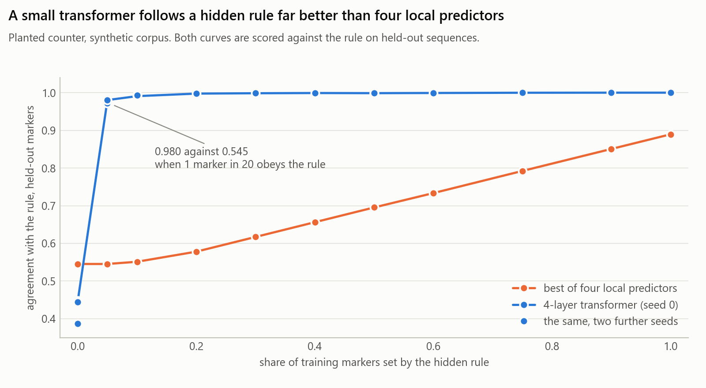
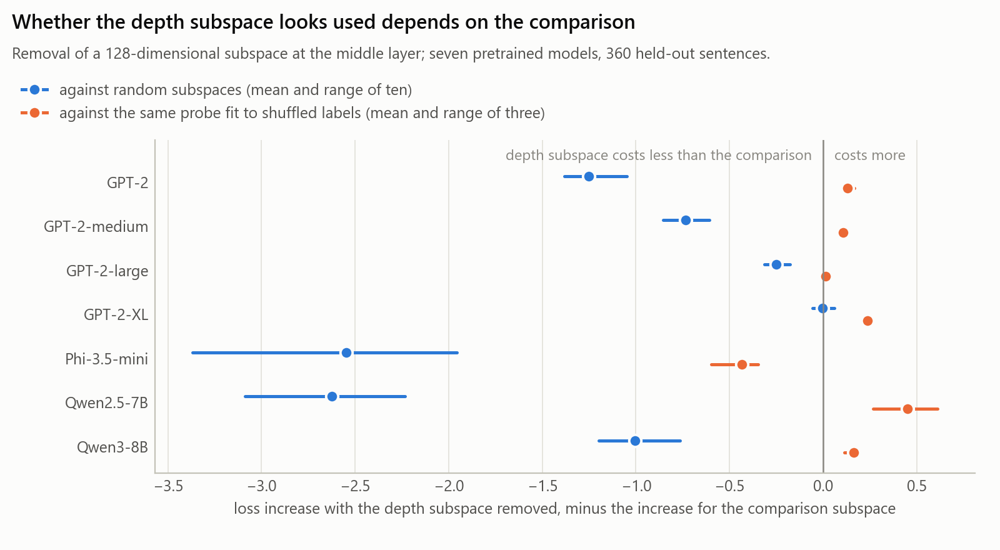

# latent-structure

Small, controlled experiments on one question: when a language model is trained on
text, does it build an internal variable for structure that nothing on the surface
points to, and does it then use that variable?

**Status:** independent research, written up as a small study in November 2026.
It has not been peer reviewed.

## Why this question

Interpretability work often argues from what can be decoded: if a probe can read
a variable from a model's activations, the model is said to represent it. A
probe shows that the information is present. It does not show that the model's
behaviour depends on it (the argument of Elazar et al., 2021), and a test of
dependence means little without a fair comparison. The experiments here try those tools where the right answer is known
(a planted variable), then apply them to a variable that is not planted
(syntactic depth), and report where the tools disagree.

## Overview

The work has three parts. Most of it was run on one 16 GB graphics card in June
2026; the tests marked below were added in November 2026.

1. **A planted structure with a known answer.** A hidden counter governs a rare
   marker token in a synthetic corpus. A small transformer trained from scratch
   follows the rule far beyond what local context allows, even when only one
   marker in twenty obeys it. Its decision is carried by eight dimensions of
   the residual stream, and the directions from which a linear probe reads the
   counter are not among them.
2. **A natural structure.** Syntactic depth is linearly decodable from GPT-2 up to
   8B-parameter models. Whether the decodable subspace is used depends on what
   its removal is compared with: against a random subspace it looks unimportant,
   against a matched comparison its removal costs more in five of seven models.
3. **A calibration on a structure people already understand** (English modal
   verbs), which shows the perturbation and evaluation tools recover known
   distinctions before they are trusted on anything else.

Every number below is read from a file in `results/`. Running
`python scripts/make_tables.py` rebuilds all tables in `results/TABLES.md` from
those files, with the source file named above each table.

## Scope and limits

Read these before the numbers.

- **Mostly one seed.** The planted-counter behaviour and the part-vector swap
  test have three training seeds. Everything else was trained and fit once.
- **Small models and small test sets.** The from-scratch models have 4 or 6
  layers. The structural probe is tested on 450 sentences; one modal contrast has
  23 items; the polarity set has 16 items.
- **Depth labels come from an automatic parser** (spaCy `en_core_web_sm`), not
  from a hand-annotated treebank.
- **The removal test is one layer and one rank.** It removes a linear subspace
  of 128 dimensions at the middle layer, so it says nothing about non-linear
  use or other layers. In Qwen2.5-7B even the mildest removal nearly doubles
  the loss (+3.116 on 3.671), so that row says little. The three larger models
  were run in bfloat16.
- **The swap tests are on a toy model.** They show which part of the residual
  vector carries the marker decision in a 4-layer model trained on a planted
  rule. In the model trained on real-text filler the probe's directions are not
  inert, unlike in the synthetic-filler models. The probe in the swap test is a
  linear discriminant; the logistic-regression probes of the June runs were not
  put through it.
- **What the swap test does and does not show.** Under these swaps the
  class-mean subspace is enough to carry the marker decision and the rest of
  the vector is not. That does not make these directions the only description
  of the mechanism, and it does not show that the model holds the counter in
  any form beyond what the decision needs. In the synthetic-filler models that
  subspace also holds almost all of the activation variance (89.8 to 99.5
  percent), so there the test separates it from the low-variance directions a
  probe reads, not from other large components. The model trained on real-text
  filler is the case where the subspace is a minority of the variance.
- **The planted corpus rewards the counter in two ways.** In the default corpus
  the legal bracket moves depend on the counter, so a model has reason to track
  it with no marker rule at all (at `rule_p` = 0 a probe still reads it at
  0.953). "Needle" mode removes that reason. It also changes the counter from a
  plain running count to one that is clipped at its bounds.
- **The baseline stored with each planted run is weak.** It counts whole contexts
  of raw tokens and is scored against the emitted marker, while the model is
  scored against the rule. `scripts/18_local_baselines.py` adds baselines scored
  the same way as the model. They need no model and were computed in November
  2026 from corpora regenerated from the seed. The n-gram predictors look back
  at most eight tokens; longer windows were not tried.
- **In the June probing runs the three largest models were loaded in 4-bit**,
  and no random-init twin was built for them.
- **The classification probes had not converged.** They are logistic regressions
  capped at 200 iterations on unstandardized activations, and the console output
  of every such run contains solver convergence warnings. Treat the codelength
  figures as rough.
- **The planted structure is synthetic.** It shows what a small transformer can
  do, not what large models do on real text.
- **The experiment that motivated the project was not run.** `scripts/12_track_c_crossing.py`
  is a training harness for testing whether adding shuffled text to a training
  pool helps a model; only a 60-second harness check exists.
- **Nothing here is about people.** Whether any of this structure matters for
  human understanding would need human data.
- **Two rounds of runs.** Most results are as recorded on 18 and 19 June 2026.
  The part-vector swap test, the removal test with its comparisons and the two
  extra training seeds were run in November 2026: on a processor for the models
  saved in June, on a rented RTX A6000 for the rest (torch 2.8.0 and
  transformers 5.12.1; the June runs used torch 2.6.0 and transformers 5.1.0).

## Models and data

- **From-scratch models.** GPT-2-style transformers with 4 or 6 layers, trained
  by the scripts here. The planted experiments use 4 layers of width 256 (about
  3.2 million parameters).
- **Pretrained models.** GPT-2, GPT-2-medium, GPT-2-large, GPT-2-XL,
  Phi-3.5-mini-instruct, Qwen2.5-7B-Instruct and Qwen3-8B, loaded from the
  Hugging Face hub and not redistributed.
- **Data.** The planted corpora are generated from a seed by
  `latent_structure/synthetic_corpus.py`. Natural text is WikiText-103 (Merity
  et al., 2017), loaded through the `datasets` library and not redistributed.
  Dependency parses come from spaCy `en_core_web_sm`.

## Findings

### 1. A small transformer follows a faint hidden rule and represents the counter behind it

The synthetic corpus is a stream of filler tokens with two bracket tokens and two
marker tokens mixed in. The brackets move a hidden counter up and down between 0
and 8. Each marker is `B` if the counter is 4 or more and `A` otherwise, with
probability `rule_p`; otherwise it is a coin flip. The counter is never written.
The model is a 4-layer GPT-2 (width 256, about 3.2 million parameters) trained
for 4,000 steps on 18,000 sequences of 256 tokens, and evaluated on 2,000
held-out sequences.

**It follows the rule beyond what local context allows.** "Marker accuracy" is
how often the model's preferred marker agrees with the rule. The comparison is
the best of four local predictors scored the same way: an n-gram over the
preceding 1, 2, 4 or 8 tokens, the same with all filler tokens merged into one
symbol, copying the previous marker, and always naming the more common side.

| rule_p | marker accuracy | best local predictor |
|---|---|---|
| 1.0 | 1.000 | 0.889 |
| 0.5 | 0.999 | 0.695 |
| 0.1 | 0.991 | 0.551 |
| 0.05 | 0.980 | 0.545 |
| 0.0 | 0.448 | 0.545 |

When every marker obeys the rule, copying the previous marker is already right
88.9 percent of the time, so the top row says little. The faint rows are the
test. At `rule_p` = 0.05 only one marker in twenty is set by the rule, earlier
markers are almost pure noise, and no local predictor does better than always
naming the more common side (0.545). The model's preference agrees with the
rule on 98.0 percent of held-out markers. With no rule (`rule_p` = 0) there is
nothing to learn and the model scores 0.448; it is not at one half because the
two sides of the threshold are not equally common. A model trained on shuffled
sequences scores 0.697 at `rule_p` = 1.0.



Two further training seeds, each with its own corpus, give the same picture: at
`rule_p` = 0.05 the models score 0.972 and 0.981 against 0.546 and 0.545 for
the best local predictor.

**The counter can be read from its activations.** A linear probe reads the
counter from the last layer with accuracy 0.998 (0.168 on a control task with
shuffled labels), and from the first layer with 0.997. The probe's codelength is
12.5 times shorter than on a random-init model of the same architecture.

**The model uses the counter, through eight dimensions.** Replacing the whole
residual vector at the prediction position with the one from a context on the
other side of the threshold flips the marker prediction in 99.1 to 100 percent
of 800 pairs at every layer (0 to 0.1 percent for a donor from the same side).
That alone only shows where the deciding information is. A second test swaps
part of the vector, on held-out sequences. Share of predictions that move to the
donor's side, at `rule_p` = 1.0:

| what is swapped | layer 1 | layer 2 | layer 3 | layer 4 |
|---|---|---|---|---|
| the whole vector | 0.993 | 0.999 | 1.000 | 1.000 |
| the 8 dimensions spanned by the counter values' mean activations | 0.994 | 0.999 | 1.000 | 1.000 |
| everything except those 8 dimensions | 0.000 | 0.000 | 0.000 | 0.000 |
| the one direction joining the two sides' means | 0.941 | 0.951 | 1.000 | 0.650 |
| the 8 directions a linear probe reads the counter from | 0.000 | 0.000 | 0.000 | 0.000 |
| 8 random dimensions (mean of five draws) | 0.000 | 0.000 | 0.000 | 0.000 |

The decision is carried entirely by an 8-dimensional subspace of the 256, and
mostly by one direction. The directions from which a linear discriminant probe
reads the counter, with 99.7 to 100 percent accuracy, carry none of it: here,
what a probe reads from is not what the model uses. The two sets of directions
barely overlap (1 to 3 percent of the class-mean subspace lies inside the
probe's). The class-mean subspace holds 93 to 99.5 percent of the activation
variance and the probe's directions 0.3 percent or less, so the probe reads the
counter from small, reliable differences while the decision rests on the large
ones.

The same holds in needle mode (class-mean subspace 0.842 to 0.997 against 0.843
to 0.999 for the whole vector; probe directions 0.001) and at `rule_p` = 0.05 in
the first three layers (0.963 to 0.984 against 0.975 to 0.988; probe directions
0.018 to 0.021, where swapping nothing gives 0.018). Two further training seeds
repeat all of it (at `rule_p` = 1.0, class-mean subspace 0.979 to 1.000 and
probe directions 0.000 at every layer).

Two exceptions. At the last layer of the `rule_p` = 0.05 models the class-mean
subspace alone does not carry the decision: swapping it flips about half of the
predictions (0.539 to 0.556 in the three seeds; whole vector 0.975 to 0.981),
and it moves 38 to 50 percent of them even when the donor is from the same
side. And in the model trained on real-text filler the probe's directions are
not inert: swapping them flips 0.086, 0.817, 0.710 and 0.991 at layers 1 to 4.

**The counter is built even when nothing else needs it, and fades with the
rule.** In the default corpus the counter also decides which bracket moves are
legal, so the model has a second reason to track it. In "needle" mode brackets
are emitted independently of the counter, so only the marker rule rewards
tracking it.

| rule_p (needle mode) | marker accuracy | best local predictor | probe accuracy | codelength ratio |
|---|---|---|---|---|
| 1.0 | 0.998 | 0.903 | 0.889 | 3.69 |
| 0.5 | 0.950 | 0.701 | 0.598 | 1.88 |
| 0.3 | 0.878 | 0.640 | 0.392 | 1.34 |
| 0.1 | 0.697 | 0.598 | 0.272 | 1.05 |
| 0.0 | 0.494 | 0.577 | 0.184 | 0.90 |

The model stays above the local predictors down to `rule_p` = 0.1 (0.697 against
0.598; 0.700 and 0.707 against 0.595 and 0.591 in two further seeds), and the
representation fades as the rule does: at 0.1 the probe's
codelength is barely shorter than on a random-init model (ratio 1.05).

**It survives real text.** With the filler tokens replaced by WikiText-103 words
in their original order, marker accuracy is 1.000 at `rule_p` = 1.0 and 0.983 at
0.3, against 0.890 and 0.618 for the best local predictor, and the whole-vector
swap flips 99.4 to 100 percent of predictions (control 0 to 0.5 percent). Here
the class-mean subspace holds only 14 to 34 percent of the activation variance,
and swapping it alone still moves 94.9 to 100 percent of predictions, while
swapping everything else moves 2.5 percent or less. The
probe is much less prominent here: the codelength ratio falls from 12.5 to 2.6
while the behaviour is unchanged, so in a model that is busy with real text, how
easily a probe reads a variable is a poor guide to how well the model tracks it.

Tables: `results/TABLES.md`, sections 1 to 3.

### 2. Syntactic depth is decodable, and whether its subspace is used depends on the comparison

Depth is a word's distance from the root of the dependency tree. The probe is the
structural norm probe of Hewitt and Manning (2019): a learned linear map `B` of
rank 128 such that the squared norm of `B h` approximates a word's depth. It is
scored by the rank correlation between predicted and true depth within each test
sentence ("norm Spearman").

| model | norm Spearman, trained | norm Spearman, random-init | root accuracy, trained | root accuracy, random-init |
|---|---|---|---|---|
| GPT-2 (layer 6) | 0.695 | 0.347 | 0.260 | 0.089 |
| GPT-2-medium (layer 12) | 0.689 | 0.344 | 0.253 | 0.093 |
| GPT-2-large (layer 18) | 0.681 | 0.314 | 0.233 | 0.076 |
| GPT-2-XL (layer 24) | 0.665 | 0.282 | 0.213 | 0.071 |
| Phi-3.5-mini (layer 16, 4-bit) | 0.585 | not built | 0.158 | not built |
| Qwen2.5-7B-Instruct (layer 21, 4-bit) | 0.612 | not built | 0.131 | not built |
| Qwen3-8B (layer 18, 4-bit) | 0.589 | not built | 0.191 | not built |

Each model was probed at two layers, at half and at three quarters of its depth.
The table gives the better of the two, which is the middle layer for every model
except Qwen2.5-7B (0.601 at its middle layer, 14).

Depth is decodable well above the random-init baseline at every size, and the
correlation does not rise with size. Root accuracy is low in absolute terms. A
second variable, the distance from a word to its syntactic head, shows the same
pattern (0.515 to 0.547 against 0.225 to 0.273 in the GPT-2 family).

**Removing the subspace.** The row space of `B` (128 dimensions) is projected out
of the residual stream at the middle layer, in standardized coordinates, and the
increase in next-token loss on 360 held-out sentences is compared with two kinds
of subspace of the same rank: the row space of the same probe fit to shuffled
depth labels (three shuffles), and random subspaces (ten).

| model | loss before | depth subspace removed | shuffled-label probe subspace removed | random subspace removed |
|---|---|---|---|---|
| GPT-2 | 4.687 | +0.971 | +0.842 (0.805 to 0.862) | +2.223 (2.018 to 2.354) |
| GPT-2-medium | 4.400 | +0.319 | +0.211 (0.199 to 0.219) | +1.052 (0.928 to 1.172) |
| GPT-2-large | 4.280 | -0.003 | -0.015 (-0.022 to -0.008) | +0.249 (0.173 to 0.311) |
| GPT-2-XL | 4.202 | +0.247 | +0.009 (-0.007 to 0.022) | +0.250 (0.186 to 0.303) |
| Phi-3.5-mini | 3.249 | +0.726 | +1.161 (1.074 to 1.324) | +3.273 (2.682 to 4.096) |
| Qwen2.5-7B-Instruct | 3.671 | +3.568 | +3.116 (2.956 to 3.301) | +6.191 (5.802 to 6.655) |
| Qwen3-8B | 3.991 | +0.372 | +0.208 (0.183 to 0.257) | +1.375 (1.135 to 1.571) |

Three readings follow.

- **A random subspace is the wrong yardstick.** In the six models where the
  shuffled-label subspace costs anything, a random one costs two to
  twenty-eight times as much. Against a random subspace the depth subspace
  looks unimportant in every model (only just in GPT-2-XL).
- **Against the matched comparison the depth subspace costs more in five of
  seven models.** Its removal costs more than that of every one of the three
  shuffled-label subspaces in GPT-2, GPT-2-medium, GPT-2-XL, Qwen2.5-7B and
  Qwen3-8B, and by far the most in GPT-2-XL (0.247 against 0.009; on tokens at
  depth 5 or more, 0.394 against 0.063). In Qwen2.5-7B the difference is small
  beside the damage any removal does there. In GPT-2-large neither removal
  costs anything. In Phi-3.5-mini the depth subspace costs less than the
  comparison.
- **The effect is modest outside GPT-2-XL**, and the shuffled-label probes are
  not empty: they still track depth weakly (norm Spearman 0.06 to 0.16).

So the same measurement supports "decodable but not used" or "decodable and
used", depending on the comparison. The matched comparison is the fairer one.



In the figure each point is the loss increase with the depth subspace removed,
minus the mean increase for a comparison subspace; the bar is the range over
the comparison draws.

**The choice of probe changes the reading.** On the same models, a 13-way
classification probe scored by online codelength finds little: accuracy 0.32 to
0.43, compression 1.2 to 1.4 at inner layers, and below 1 at the final layer of
five of the seven models. On a 4-layer model trained from scratch on parsed
WikiText, the same probe reaches accuracy 0.33 against a majority baseline of
0.22, yet its codelength is no better than on a random-init model (ratio 0.98 to
1.09). Probe accuracy alone, and a single probe family alone, would each have
given a different answer.

Tables: `results/TABLES.md`, sections 4 to 7.

### 3. The tools recover known distinctions among modal verbs

Modal verbs are detected with a part-of-speech-aware matcher and grouped by force
(possibility, weak necessity, necessity, prediction). Small GPT-2 models are
trained from scratch on WikiText-103 variants in which modals have been masked,
deleted, swapped within a force class, swapped across force classes, or negated,
and are always evaluated on clean held-out text.

**The effect is specific to what was perturbed.** Change in next-token loss
against the clean-trained model, 4-layer models:

| trained on | loss on modal tokens | loss on control tokens |
|---|---|---|
| modals masked | +6.26 | -0.01 |
| frequency-matched control words masked | +0.04 | +9.23 |

Overall loss barely moves in either case (7.38 and 7.39 against 7.36), which is
why the loss is reported by token category.

**Each perturbation damages its own contrast.** Share of minimal pairs on which
the model prefers the original modal (6-layer models; chance is 0.5):

| trained on | cross-force pairs | polarity pairs | within-force pairs |
|---|---|---|---|
| clean | 0.950 | 0.742 | 0.805 |
| cross-force swaps | 0.335 | 0.710 | 0.664 |
| polarity flips | 0.804 | 0.290 | 0.744 |
| within-force swaps | 0.875 | 0.699 | 0.323 |

**The must/should contrast is the hardest.** The clean 6-layer model separates
possibility from necessity on 97.2 percent of 215 pairs and necessity from weak
necessity on 73.9 percent of 23 pairs.

**No learned force axis was found.** A probe at the modal token classifies force
with accuracy 0.85 to 0.91, but its codelength is no better than on a random-init
model at most layers (ratio 0.64 to 1.24), and a random-init model shows the same
apparent ordering of the three force classes (Spearman up to 0.67, against 0.50
to 0.58 in the trained model). At the position before the modal, the trained
model predicts force no better than random-init (ratio 0.52 to 0.88). The probe
reads which token it is, not a learned scale.

Tables: `results/TABLES.md`, section 9.

### 4. Two smaller results

**Forced-polarity pairs (16 items, a pilot).** Each item is a sentence whose
context forces "must" or "must not", "can" or "cannot". The from-scratch models
score 5 and 6 of 16, the GPT-2 family 12 to 13, and the three instruct models 14
to 15. Sixteen items cannot support more than the ordering.

**Sparse autoencoders.** Trained on the planted model, a sparse autoencoder
(about 35 active features per token) has one feature that correlates 0.774 with
the hidden counter, and a linear readout from the sparse code recovers the
counter as well as from raw activations (Spearman 0.992 for both). Trained on
GPT-2 layer 6 over 60,000 tokens of WikiText, with about 36 active features per
token, 1,431 features are active: 129 are dominated by one token, 3 are explained
by part of speech, depth, position or frequency, and 1,299 by none of those. The
highest-ranked of the 1,299 are ordinary lexical features ("m2, km2", "gill,
gills", "record, records"). The filter does not include word meaning, so
"unexplained" here means unexplained by a short list of properties, not novel.

Tables: `results/TABLES.md`, sections 8 and 10.

## Open questions

- The experiment that prompted the project (does adding low-quality text to a
  training pool help a model?) was not run.
- Everything outside the planted behaviour and the swap test rests on one seed.
- The swap test was not run with a logistic-regression probe, and why the
  probe's directions matter in the real-text model and not in the synthetic
  ones was not investigated.
- The removal test covers one layer and one rank per model, with three
  shuffled-label comparisons. More layers, ranks and shuffles would show how
  far the dependence on the comparison goes.
- No model above 8B parameters was tested.

## Reproduce

```
pip install -r requirements.txt
python -m spacy download en_core_web_sm
python -m pytest -q                      # detection and perturbation tests, no GPU
python scripts/make_tables.py            # rebuild results/TABLES.md, no GPU
python scripts/18_local_baselines.py     # local baselines for the planted counter,
                                         # no GPU, several minutes
python scripts/make_figures.py           # rebuild figures/, no GPU, needs matplotlib
```

The experiments need a GPU. Outputs go to `storage_root` in `config/pilot.yaml`
(default `./storage`), in the same layout as `results/`.

```
# planted structure (edit config: planted.rule_p_sweep, needle_mode, carrier_mode, shuffle_control)
python scripts/05_run_planted.py       --config config/pilot.yaml
python scripts/06_probe_planted.py     --config config/pilot.yaml
python scripts/07_intervene_planted.py --config config/pilot.yaml --condition rule_p_1.0
python scripts/19_subspace_interchange.py --config config/pilot.yaml --conditions rule_p_1.0   # no GPU needed
python scripts/05_run_planted.py       --config config/pilot.yaml --seed 1                  # another seed

# natural structure
python scripts/08_run_phaseB.py              --config config/pilot.yaml
python scripts/10_probe_pretrained_depth.py  --config config/pilot.yaml --model gpt2 --label depth
python scripts/13_structural_probe.py        --config config/pilot.yaml --model gpt2
python scripts/14_causal_depth.py            --config config/pilot.yaml --model gpt2
python scripts/15_causal_depth_buckets.py    --config config/pilot.yaml --model gpt2
#   larger models: add --load-4bit (and --no-random-init for scripts 10 and 13);
#   script 15 also runs them unquantized on a 48 GB card

# modal calibration
python scripts/01_build_datasets.py        --config config/pilot.yaml
python scripts/02_inspect_perturbations.py --config config/pilot.yaml
python scripts/03_train_smoke.py           --config config/pilot.yaml   # add --size small
python scripts/04_eval_minimal_pairs.py    --config config/pilot.yaml
python scripts/09_force_geometry.py        --config config/pilot.yaml --size small
python scripts/11_polarity_reasoning.py    --config config/pilot.yaml

# sparse autoencoders
python scripts/16_sae_calibrate.py --config config/pilot.yaml --condition rule_p_1.0
python scripts/17_sae_discover.py  --config config/pilot.yaml --model gpt2 --layer 6
```

The planted sweep in the tables was produced by running script 05 several times
with different settings of `planted` in the config (the synthetic sweep, the
shuffled-sequence control, needle mode, and the natural carrier).

## Layout

```
latent_structure/   library: corpus building, modal detection and perturbation,
                    planted corpus, probes, interchange intervention, structural
                    probe and subspace removal, sparse autoencoder
scripts/            numbered experiment scripts, make_tables.py and make_figures.py
tests/              modal detection and perturbation tests
config/pilot.yaml   all settings
results/            recorded result files and TABLES.md
figures/            two figures drawn from results/ by scripts/make_figures.py
```

`results/` holds the result files written by the scripts, the training histories
of every run, and nine console logs (in `results/logs/`) that are the only record
of some probe figures. The files written in November 2026 are
`results/causal_depth_by_depth_*.json`, `results/planted/local_baselines.json`,
`results/planted/subspace_interchange*.json` and the training histories in the
`results/planted/*_seed1` and `*_seed2` folders; everything else is from June.
The logs were filtered: progress bars and library warnings were removed and
machine paths replaced. Model checkpoints and generated corpora are not
included.

## How this was built

The code, the analysis scripts and the drafts of the documentation were produced
with Claude Code (Anthropic) under the author's direction. The questions and the
design of the June experiments are the author's. The November 2026 follow-up
tests were proposed and run by the assistant during an audit the author asked
for, and reviewed by the author.

## Licence

MIT. See `LICENSE`. WikiText-103 and the pretrained models are not redistributed
and carry their own terms.

## References

- Elazar, Ravfogel, Jacovi and Goldberg (2021). Amnesic Probing: Behavioral
  Explanation with Amnesic Counterfactuals. TACL.
- Geiger, Lu, Icard and Potts (2021). Causal Abstractions of Neural Networks.
  NeurIPS.
- Hewitt and Liang (2019). Designing and Interpreting Probes with Control Tasks.
  EMNLP.
- Hewitt and Manning (2019). A Structural Probe for Finding Syntax in Word
  Representations. NAACL.
- Merity, Xiong, Bradbury and Socher (2017). Pointer Sentinel Mixture Models.
  ICLR. (WikiText-103.)
- Mohri, Duchi and Hashimoto (2026). A Bitter Lesson for Data Filtering.
  arXiv:2605.19407. (The paper that prompted the project: it reports that
  large models can benefit from nominally low-quality training text.)
- Sutton (2019). The Bitter Lesson.
- Voita and Titov (2020). Information-Theoretic Probing with Minimum Description
  Length. EMNLP.
